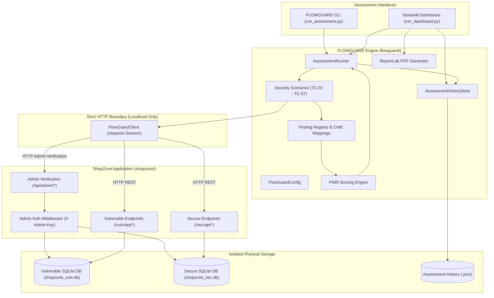
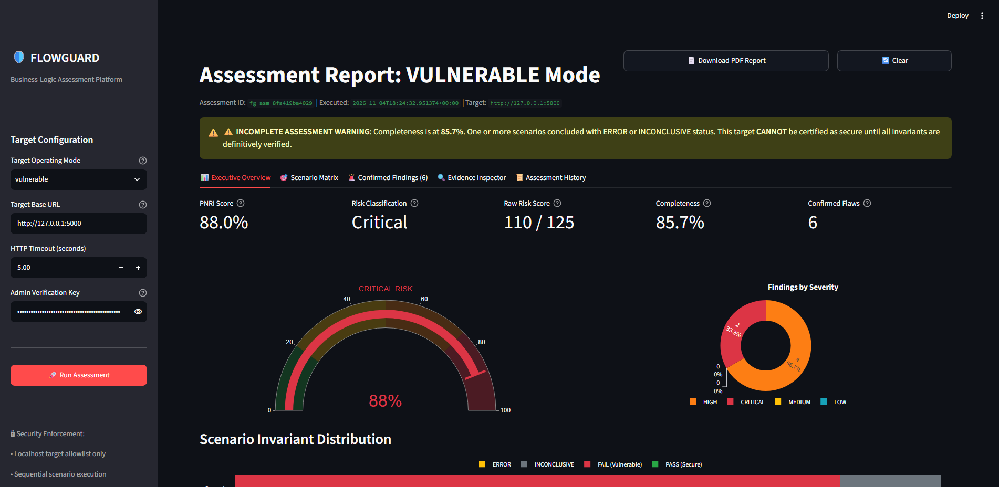
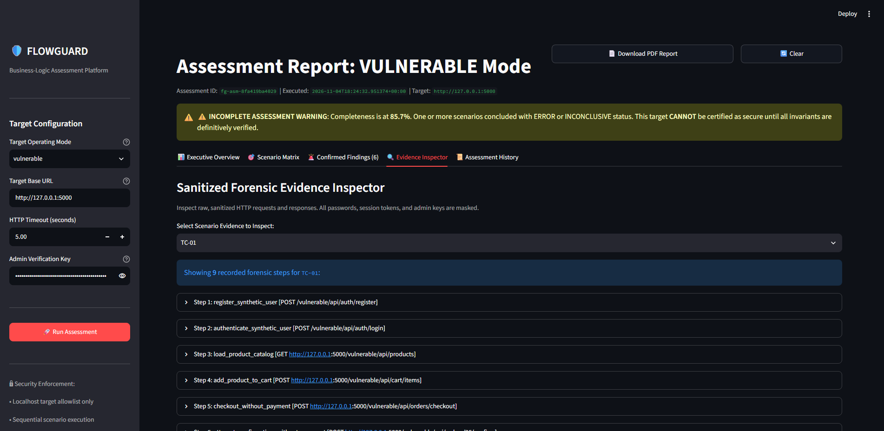
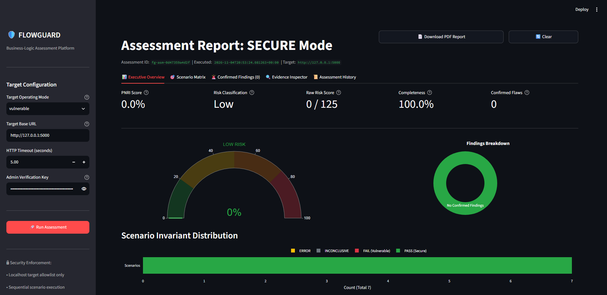
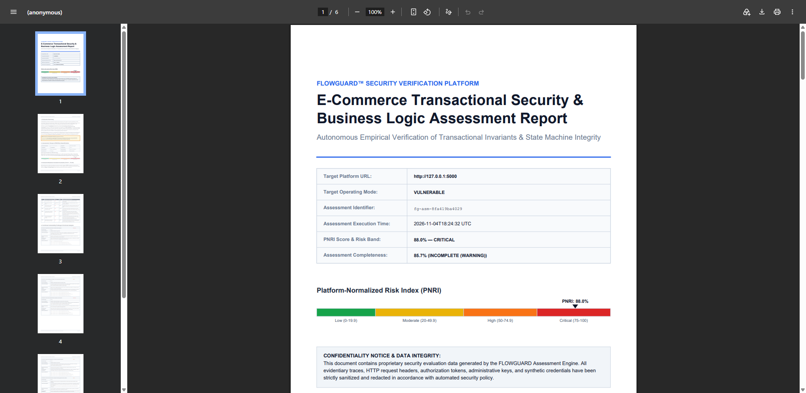

# FLOWGUARD — Automated Business-Logic Security Assessment Platform

[](https://www.python.org/)
[](https://palletsprojects.com/p/flask/)
[](tests/)
[](#security-and-responsible-use-disclaimer)
[](#license)

FLOWGUARD is an empirical, automated cybersecurity assessment platform engineered to detect, quantify, and document **business-logic vulnerabilities** in modern transactional web applications. 

Unlike traditional Dynamic Application Security Testing (DAST) or static analysis tools that focus on technical injection flaws (such as SQLi or XSS), FLOWGUARD systematically validates transactional invariants, state machine transitions, concurrency race conditions, and tenant isolation policies.

---

## Table of Contents

- [Problem Statement](#problem-statement)
- [Key Features](#key-features)
- [Architecture Overview](#architecture-overview)
- [Technology Stack](#technology-stack)
- [Target Separation & Ground-Truth Verification](#target-separation--ground-truth-verification)
- [Automated Security Scenarios (TC-01 – TC-07)](#automated-security-scenarios-tc-01--tc-07)
- [PNRI Risk Quantification Framework](#pnri-risk-quantification-framework)
- [Assessment Outcomes (Vulnerable vs. Secure)](#assessment-outcomes-vulnerable-vs-secure)
- [Installation Guide (Windows)](#installation-guide-windows)
- [Environment Configuration](#environment-configuration)
- [Quick Start Guide](#quick-start-guide)
- [CLI Reference](#cli-reference)
- [Visual Dashboard (Streamlit)](#visual-dashboard-streamlit)
- [Executive PDF Reporting](#executive-pdf-reporting)
- [Automated Test Suite](#automated-test-suite)
- [User Interface Screenshots](#user-interface-screenshots)
- [Security and Responsible-Use Disclaimer](#security-and-responsible-use-disclaimer)
- [Current Limitations](#current-limitations)
- [Documentation Directory](#documentation-directory)

---

## Problem Statement

Business-logic vulnerabilities represent some of the most critical risks in transactional systems, leading directly to financial losses, inventory exhaustion, and unauthorized data disclosure. Because business logic is unique to each application, automated vulnerability scanners typically cannot detect these flaws:

- They cannot determine whether an unpaid order transitioning directly to `CONFIRMED` violates application rules.
- They cannot detect whether a promotional coupon intended to be globally single-use can be redeemed across multiple concurrent user sessions.
- They cannot verify whether a server honors client-submitted checkout totals rather than recalculating prices from an authoritative database.

FLOWGUARD solves this problem by combining simulated multi-session adversarial workflows with **independent ground-truth verification** through protected administrative interfaces.

---

## Key Features

- **Automated Black-Box Attack Simulation**: Simulates realistic adversarial operations across multiple authenticated synthetic users over pure HTTP/REST interfaces.
- **Authoritative Ground-Truth Corroboration**: Evaluates server database state via read-only admin verification routes to distinguish real business-logic breaches from surface-level HTTP responses.
- **Strict Network & Origin Containment**: Enforces local loopback execution (`127.0.0.1`, `localhost`, `::1`), rejecting external targets to prevent accidental scanning.
- **Fail-Closed Secret Redaction**: Automatically sanitizes passwords, session tokens, authorization headers, and administrative keys across logs, evidence records, dashboard views, and exported PDFs.
- **Project-Specific Normalized Risk Index (PNRI)**: Quantifies aggregate transactional risk on a standardized 0.0 to 100.0 scale, mapped strictly to vulnerability severity and test completeness.
- **Interactive Visual Dashboard**: High-performance Streamlit UI featuring live assessment execution, scenario metrics, evidence inspectors, and interactive history review.
- **Audit-Ready Executive PDF Reports**: Automated generation of professional, publication-quality executive reports via ReportLab, complete with risk banding, methodology breakdowns, and technical remediation guidance.

---

## Architecture Overview

The platform consists of two cleanly separated software subsystems:

1. **ShopZone (Target Lab)**: A lightweight e-commerce API built with Flask and SQLAlchemy that exposes two physically separate operating modes:
   - `/vuln/api/*`: Vulnerable implementation with deliberate business-logic flaws.
   - `/sec/api/*`: Hardened implementation enforcing atomic transactional invariants.
   - `/api/admin/*`: Protected administrative endpoints for health checks, synthetic test data provisioning, and ground-truth inspection.
2. **FLOWGUARD (Assessment Engine)**: An independent client and evaluation framework that executes sequential test scenarios against the target over HTTP, computes the PNRI score, stores historical records, and renders visual analytics.



---

## Technology Stack

| Category | Technology | Purpose |
| :--- | :--- | :--- |
| **Language** | Python 3.12 | Core development runtime across all components |
| **Target Application** | Flask 3.1.0, Werkzeug 3.1.3 | Lightweight, decoupled REST API for ShopZone |
| **ORM & Database** | SQLAlchemy 2.0.40, SQLite3 | Relational modeling with WAL mode and foreign keys |
| **HTTP Client** | Requests 2.34.2 | Controlled HTTP transport with timeout management |
| **Visual Dashboard** | Streamlit 1.60.0 | High-fidelity interactive UI and visual analytics |
| **Data Visualization** | Plotly 6.9.0 | Risk gauge meters and severity distribution charts |
| **Document Generation** | ReportLab 5.0.1 | Presentation-ready, multi-page executive PDF reporting |
| **Testing Framework** | Pytest 9.2.0 | Unit, integration, and security regression test suite |
| **Configuration** | Python-Dotenv 1.2.4 | Centralized environment variable loading |

---

## Target Separation & Ground-Truth Verification

FLOWGUARD maintains strict operational boundaries to guarantee assessment objectivity:

1. **Zero Shared In-Memory State**: FLOWGUARD never imports ShopZone internal route handlers or accesses internal state in memory during live runs.
2. **Pure HTTP Communication**: All interactions with the target take place exclusively over HTTP request/response exchanges.
3. **Physical Database Isolation**: ShopZone maintains two completely independent SQLite database files on disk:
   - `instance/shopzone_vuln.db`: Dedicated database for vulnerable-mode operations.
   - `instance/shopzone_sec.db`: Dedicated database for secure-mode operations.
4. **Independent Ground-Truth Verification**: After simulated attacks (e.g., replaying checkout requests), FLOWGUARD queries protected admin verification routes (`/api/admin/verify/*`) with an administrative key to confirm whether the server database committed invalid transactions.
5. **No Direct Database Access**: FLOWGUARD never connects directly to ShopZone SQLite databases via SQL drivers; all inspections occur through authorized HTTP verification endpoints.

---

## Automated Security Scenarios (TC-01 – TC-07)

FLOWGUARD automates seven business-logic security test scenarios:

| ID | Scenario Title | Severity | CWE Mapping | Business Logic Invariant Verified |
| :--- | :--- | :---: | :---: | :--- |
| **TC-01** | Payment Bypass | **CRITICAL** (25) | [CWE-840](https://cwe.mitre.org/data/definitions/840.html) | Orders in `PENDING_PAYMENT` state cannot transition to `CONFIRMED` without an authoritative, verified payment transaction. |
| **TC-02** | Coupon Reuse | **HIGH** (15) | [CWE-670](https://cwe.mitre.org/data/definitions/670.html) | Single-use promotional coupons must be redeemed at most once across all registered user accounts. |
| **TC-03** | Duplicate Order Creation | **HIGH** (15) | [CWE-840](https://cwe.mitre.org/data/definitions/840.html) | Replaying checkout submissions with the same idempotency key must not create duplicate orders or deduct duplicate inventory. |
| **TC-04** | Order IDOR | **CRITICAL** (25) | [CWE-639](https://cwe.mitre.org/data/definitions/639.html) | Users cannot view, modify, or disclose orders belonging to other tenants via manipulated order identifiers. |
| **TC-05** | Invalid Workflow Transitions | **HIGH** (15) | [CWE-840](https://cwe.mitre.org/data/definitions/840.html) | Order lifecycles must follow strict finite state transitions (`PENDING -> PAID -> CONFIRMED`); terminal states cannot be resurrected or mutated. |
| **TC-06** | Concurrent Checkout Race | **HIGH** (15) | [CWE-362](https://cwe.mitre.org/data/definitions/362.html) | Concurrent checkout requests under high concurrency must be serialized atomically without overselling stock or duplicating orders. |
| **TC-07** | Client-Side Price Tampering | **HIGH** (15) | [CWE-472](https://cwe.mitre.org/data/definitions/472.html) | Order totals, line-item amounts, and discounts must be calculated authoritatively on the server; client-submitted totals are ignored. |

For detailed attack payloads, sequence diagrams, and remediation guidance, see [docs/SCENARIOS.md](docs/SCENARIOS.md).

---

## PNRI Risk Quantification Framework

The **Project-Specific Normalized Risk Index (PNRI)** is a proprietary, normalized scoring model designed for FLOWGUARD to quantify cumulative business-logic risk.

> [!NOTE]
> PNRI is a project-specific composite metric tailored for transactional invariants; it is not an industry-wide standard like CVSS.

### Mathematical Formulation

$$\text{PNRI} = \left(\frac{\sum \text{Weights of Confirmed Findings}}{\text{Max Possible Raw Score}}\right) \times 100$$

Where:
- $\text{Max Possible Raw Score} = 25 (\text{TC-01}) + 15 (\text{TC-02}) + 15 (\text{TC-03}) + 25 (\text{TC-04}) + 15 (\text{TC-05}) + 15 (\text{TC-06}) + 15 (\text{TC-07}) = 125$
- Confirmed Findings are derived **strictly** from scenarios that returned a verified `FAIL` status corroborated by ground-truth evidence.

### Qualitative Risk Bands

| PNRI Score Range | Qualitative Risk Band | Typical Security Posture |
| :---: | :---: | :--- |
| **0.0 – 19.99** | **Low Risk** | Strong transactional defenses; all evaluated invariants enforced. |
| **20.0 – 49.99** | **Moderate Risk** | Isolated logic bypasses present; requires scheduled remediation. |
| **50.0 – 74.99** | **High Risk** | Multiple high-severity vulnerabilities; risk of substantial loss. |
| **75.0 – 100.0** | **Critical Risk** | Systemic failure across core invariants; immediate remediation required. |

### Assessment Completeness & Fail-Closed Policy

$$\text{Completeness} = \left(\frac{\text{Conclusive Scenarios (PASS + FAIL)}}{7}\right) \times 100$$

- If any scenario returns `ERROR` or `INCONCLUSIVE`, completeness drops below $100.0\%$.
- **Strict Security Policy**: Under FLOWGUARD policy, **an incomplete assessment can NEVER be certified as secure**.
- Unverified scenarios contribute 0 points to the confirmed risk score, but trigger high-visibility warning banners across all reporting outputs.

For full mathematical proofs, see [docs/PNRI_METHODOLOGY.md](docs/PNRI_METHODOLOGY.md).

---

## Assessment Outcomes (Vulnerable vs. Secure)

### Vulnerable Mode Execution (`python run_assessment.py --mode vulnerable`)
```text
============================================================================
   FLOWGUARD — Automated Business-Logic Security Assessment Engine
============================================================================
 Target URL : http://127.0.0.1:5000
 Target Mode: VULNERABLE
----------------------------------------------------------------------------
 TC-01  [FAIL]            613ms  Admin verification confirms an unpaid order reached CONFIRMED.
 TC-02  [FAIL]           1232ms  Admin verification confirms a globally single-use coupon was redeemed by multiple users.
 TC-03  [FAIL]            627ms  Duplicate order creation confirmed: sequential checkout with identical key created distinct orders #71 and #72.
 TC-04  [FAIL]           1169ms  Vulnerable mode permitted unauthorized user B to access victim user A's order details.
 TC-05  [FAIL]            750ms  Vulnerable mode permitted multiple invalid workflow transitions.
 TC-06  [FAIL]            688ms  Vulnerable mode permitted duplicate order creation under concurrent same-key checkout.
 TC-07  [FAIL]            622ms  Vulnerable mode permitted client-side price tampering (order #80 accepted tampered total of 100 minor units).
----------------------------------------------------------------------------
 METRICS & PNRI RISK INDEX
----------------------------------------------------------------------------
 Raw Risk Score : 125 / 125
 PNRI Score     : 100.00 / 100.00 (Critical Risk)
 Completeness   : 100.0%
 Scenarios Total: 7
 Confirmed Flaws: 7
============================================================================
```

> [!NOTE]
> **Understanding Concurrency Testing & INCONCLUSIVE Outcomes:**  
> TC-06 evaluates a multi-threaded checkout race condition. When thread execution triggers the collision and admin verification confirms duplicate order commits, TC-06 yields `FAIL` (resulting in Raw Risk 125/125, PNRI 100.0%, Completeness 100.0%).  
> However, because race conditions are inherently timing-sensitive, if thread scheduling or SQLite locks resolve sequentially without observing the race window, TC-06 correctly returns `INCONCLUSIVE`. In that outcome, metrics evaluate to Raw Risk 110/125, PNRI 88.00% (Critical Risk), and Completeness 85.71%.  
> Under FLOWGUARD's fail-closed governance policy, **an incomplete assessment (< 100.0% completeness) can never be described as fully verified or certified secure**.

### Secure Mode Execution (`python run_assessment.py --mode secure`)
```text
============================================================================
   FLOWGUARD — Automated Business-Logic Security Assessment Engine
============================================================================
 Target URL : http://127.0.0.1:5000
 Target Mode: SECURE
----------------------------------------------------------------------------
 TC-01  [PASS]            618ms  Secure mode returned expected unpaid-order rejection.
 TC-02  [PASS]           1207ms  Admin verification confirms only first user redeemed single-use coupon.
 TC-03  [PASS]            645ms  Idempotent checkout verified; duplicate creation blocked.
 TC-04  [PASS]           1165ms  Secure mode enforced object-level authorization (HTTP 404).
 TC-05  [PASS]            753ms  Secure mode strictly enforced finite state machine invariants.
 TC-06  [PASS]            810ms  Secure mode strictly enforced checkout concurrency invariants.
 TC-07  [PASS]            611ms  Secure mode strictly enforced server-authoritative pricing.
----------------------------------------------------------------------------
 METRICS & PNRI RISK INDEX
----------------------------------------------------------------------------
 Raw Risk Score : 0 / 125
 PNRI Score     : 0.00 / 100.00 (Low Risk)
 Completeness   : 100.0%
 Scenarios Total: 7
 Confirmed Flaws: 0
============================================================================
```

---

## Installation Guide (Windows)

### Prerequisites

- **Windows 10 / 11** (PowerShell or Windows Terminal)
- **Python 3.12+** installed and available on PATH (`python --version`)
- **VS Code** (Optional, recommended for debugging)

### Step 1: Clone or Navigate to the Workspace
```powershell
git clone https://github.com/<your-username>/FLOWGUARD.git
cd FLOWGUARD
```

### Step 2: Create and Activate a Virtual Environment
```powershell
python -m venv venv
.\venv\Scripts\Activate.ps1
```

### Step 3: Install Required Dependencies
```powershell
python -m pip install --upgrade pip
pip install -r requirements.txt
```

For complete installation troubleshooting, see [docs/INSTALLATION.md](docs/INSTALLATION.md).

---

## Environment Configuration

Copy the example configuration file to create your local `.env`:

```powershell
Copy-Item .env.example .env
```

Review the default `.env` contents:

```env
# Required administrative key for ground-truth verification
ADMIN_KEY=flowguard_admin_secret_key_change_me_local_lab

# Target laboratory network binding
SHOPZONE_HOST=127.0.0.1
SHOPZONE_PORT=5000
SHOPZONE_DEBUG=False

# Physical SQLite database paths
VULN_DB_PATH=instance/shopzone_vuln.db
SEC_DB_PATH=instance/shopzone_sec.db
```

---

## Quick Start Guide

Running FLOWGUARD requires two primary processes: the **ShopZone Target Server** and an interface (**CLI** or **Streamlit Dashboard**).

### Terminal 1 — Start ShopZone Target API
```powershell
python run_shopzone.py
```
*Leave running. ShopZone initializes the databases and listens at `http://127.0.0.1:5000`.*

### Terminal 2 — Launch Streamlit Visual Dashboard
```powershell
python run_dashboard.py
```
*Opens your default browser to `http://localhost:8501`.*

### Terminal 3 — Interactive CLI & Test Suite
Use this terminal to run standalone assessments or verify tests:

```powershell
# Run assessment against Secure profile:
python run_assessment.py --mode secure

# Run assessment against Vulnerable profile:
python run_assessment.py --mode vulnerable

# Run the complete test suite:
python -m pytest tests -q
```

---

## CLI Reference

`run_assessment.py` provides command-line control over assessment execution:

```text
usage: run_assessment.py [-h] --mode {vulnerable,secure} [--target-url TARGET_URL]
                         [--timeout TIMEOUT] [--admin-key ADMIN_KEY]
                         [--scenario SCENARIO] [--json]

FLOWGUARD — E-Commerce Business Logic Security Assessment Engine

options:
  -h, --help            Show this help message and exit
  --mode {vulnerable,secure}
                        Target ShopZone operating mode (required)
  --target-url TARGET_URL
                        Base URL of target instance (default: http://127.0.0.1:5000)
  --timeout TIMEOUT     Per-request HTTP timeout in seconds (default: 5.0)
  --admin-key ADMIN_KEY
                        ShopZone X-Admin-Key for ground-truth verification
  --scenario SCENARIO   Run a specific scenario (e.g. TC-01) or 'all' (default: all)
  --json                Output the final assessment summary as sanitized JSON
```

### Examples

Execute single scenario in vulnerable mode:
```powershell
python run_assessment.py --mode vulnerable --scenario TC-01
```

Export sanitized JSON assessment summary:
```powershell
python run_assessment.py --mode secure --json > secure_summary.json
```

---

## Visual Dashboard (Streamlit)

The visual dashboard (`run_dashboard.py`) provides an interactive interface for assessing and analyzing target behavior:

1. **Assessment Control Panel**: Configure target URL, select operating mode, set timeouts, and execute assessments with single-click triggers.
2. **Executive Overview**: Gauge meters displaying PNRI score, risk classification, completeness status, and execution duration.
3. **Scenario Matrix**: Tabular overview of TC-01 through TC-07 outcomes (`PASS`, `FAIL`, `INCONCLUSIVE`, `ERROR`) with detailed timing metrics.
4. **Findings & Evidence Inspector**: Expandable cards displaying canonical CWE mappings, business impact, remediation steps, and sanitized request/response evidence.
5. **Historical Analysis**: Chronological assessment browser to compare past runs and track remediation progress.
6. **Executive PDF Export**: Instant generation and download of publication-ready security reports.

---

## Executive PDF Reporting

FLOWGUARD includes an integrated PDF reporting engine powered by ReportLab. Reports are generated without rerunning assessments, using cached `AssessmentSummary` data:

- **Executive Summary**: High-level narrative deriving vulnerability statements strictly from confirmed findings.
- **Risk Metrics**: Visual summary of raw scores, PNRI index, risk band, and completeness warnings.
- **Scenario Breakdown**: Tabular presentation of all seven test cases with unwrapped, multi-line diagnostic observations.
- **Technical Analysis**: Comprehensive vulnerability descriptions, business impact analyses, code-level remediation steps, and sanitized evidence records.
- **Scope & Limitations**: Disclaimers emphasizing transactional invariant scope and incomplete-run caveats.

Generate a report programmatically:
```python
from flowguard.history import AssessmentHistoryStore
from flowguard.reporting import generate_pdf_report

store = AssessmentHistoryStore()
summary = store.load_assessment("fg-asm-xxxxxxxxxxxx")
pdf_bytes = generate_pdf_report(summary, output_path="report.pdf")
```

---

## Automated Test Suite

FLOWGUARD includes a comprehensive test suite of 383 unit, integration, and security regression tests:

```powershell
python -m pytest tests -q
```

### Expected Output
```text
........................................................................ [ 18%]
........................................................................ [ 37%]
........................................................................ [ 56%]
........................................................................ [ 75%]
........................................................................ [ 93%]
.......................                                                  [100%]
======================= 383 passed, 1 warning in 284.57s =======================
```

### Test Coverage Highlights
- `tests/test_tc01_payment_bypass.py` – `tests/test_tc07_price_tampering.py`: Exhaustive functional tests for all scenarios.
- `tests/test_admin.py`: Authentication, ground-truth verification, and input validation tests.
- `tests/test_runner_and_scoring.py`: Sequential execution, PNRI calculation, and error isolation.
- `tests/test_dashboard.py`: Streamlit rendering, session state, and history retrieval.
- `tests/test_reporting.py`: Decompressed PDF stream inspection, credential redaction, and table formatting.

---

## User Interface Screenshots

The following captures depict the genuine FLOWGUARD application during live runtime execution. All sensitive tokens, authorization headers, passwords, and administrative keys are automatically sanitized by the platform's defensive redaction engine.

### 1. Streamlit Assessment Dashboard (Vulnerable Profile)
*Executive overview displaying the Project-Specific Normalized Risk Index (PNRI) radial score gauge (88.0% Critical Risk), incomplete assessment warning banner, and composite risk breakdown.*  


### 2. Sanitized Forensic Evidence Inspector
*Expanded forensic evidence card for confirmed vulnerabilities displaying sanitized HTTP requests, redacted credentials (`password: ***REDACTED***`, `Authorization: Bearer ***REDACTED***`), and authoritative admin ground truth.*  


### 3. Hardened Defense Verification (Secure Profile)
*Verification of transactional defenses against the secure target profile, demonstrating 0.00% PNRI (Low Risk), 100.0% completeness, and zero confirmed vulnerabilities.*  


### 4. Executive PDF Report
*Publication-quality executive report generated via ReportLab with audit metadata, fail-closed completeness attestation, and quantitative risk breakdown.*  


*For the complete gallery of captured full-resolution screens (including Main Landing View and Scenario Matrices), see the [screenshots/](screenshots/) directory.*

---

## Security and Responsible-Use Disclaimer

> [!CAUTION]
> **RESTRICTED TARGET POLICY:** FLOWGUARD is designed and authorized **exclusively** for controlled laboratory testing against the local ShopZone target.

- **Localhost Boundary**: FLOWGUARD enforces strict validation blocking non-loopback hostnames. It will reject attempts to target external IP addresses or domain names.
- **Safe Environment**: ShopZone utilizes local SQLite databases. It contains no external payment processor integrations, real banking connections, or live third-party dependencies.
- **Authorization**: Do not attempt to adapt or point FLOWGUARD at third-party applications or production systems without explicit, documented authorization.
- **Credential Protection**: FLOWGUARD incorporates defensive redaction algorithms designed to strip secrets from logs and reports. However, users should never configure production credentials in laboratory `.env` files.

---

## Current Limitations

1. **Synthetic Coupon Growth in Laboratory Storage**: In persistent development testing without database wipes, each automated run creates one synthetic single-use coupon (`SYNTH_CPN_<hex>`). Over thousands of executions, synthetic coupons accumulate in SQLite unless `POST /api/admin/reset` is called.
2. **Single-Process Concurrency Window (TC-06)**: When executing TC-06 against vulnerable mode in single-process development servers, extremely fast SQLite writes (<1ms) can occasionally clear the cart before concurrent threads begin processing. In such cases, FLOWGUARD safely fails closed to `INCONCLUSIVE` rather than fabricating a false outcome.
3. **Assessment Scope**: FLOWGUARD validates transactional and business-logic invariants over HTTP APIs. It does not evaluate operating system security, network infrastructure, memory safety, or DDoS resilience.

---

## Documentation Directory

For in-depth architectural, operational, and mathematical documentation, consult the dedicated guides in the `docs/` folder:

- [docs/ARCHITECTURE.md](docs/ARCHITECTURE.md) — Comprehensive technical architecture, separation boundaries, and component interaction flows.
- [docs/INSTALLATION.md](docs/INSTALLATION.md) — Step-by-step Windows installation, virtual environment setup, and VS Code integration.
- [docs/SCENARIOS.md](docs/SCENARIOS.md) — In-depth breakdown of TC-01 through TC-07, CWE mappings, payloads, and remediation code.
- [docs/PNRI_METHODOLOGY.md](docs/PNRI_METHODOLOGY.md) — Detailed mathematical formulation of the Project-Specific Normalized Risk Index.
- [docs/USER_GUIDE.md](docs/USER_GUIDE.md) — Complete operational manual for the CLI, Streamlit dashboard, history store, and PDF generation.

---

## License

This project is licensed under a Private Educational / Proprietary License for authorized laboratory assessment and academic research. Unauthorized redistribution or commercial deployment is strictly prohibited.
