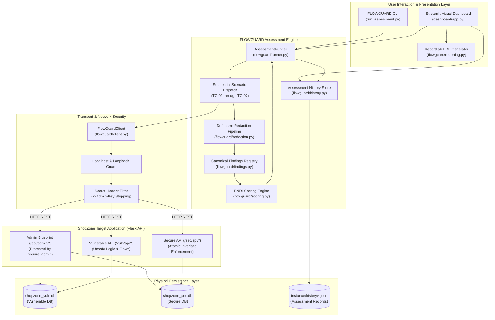
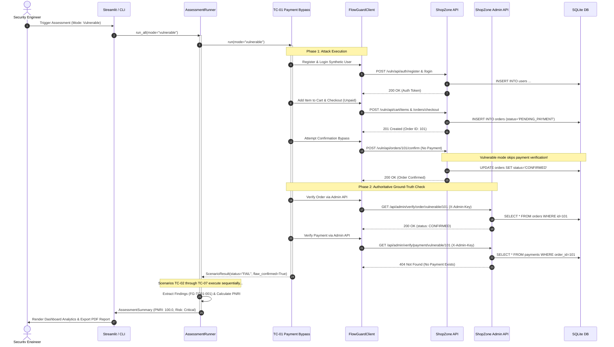

# FLOWGUARD System Architecture Documentation

## 1. Architectural Principles & Philosophy

FLOWGUARD was engineered as an independent, empirical assessment platform designed to validate transactional invariants in e-commerce workflows. The system adheres to several strict architectural principles:

1. **Complete Decoupling**: The assessment engine (FLOWGUARD) and the target application (ShopZone) are independent subsystems. FLOWGUARD communicates with ShopZone exclusively over standard HTTP/REST interfaces. FLOWGUARD never shares in-memory state or Python module references with ShopZone.
2. **Physical Data Isolation**: ShopZone maintains two physically separate SQLite databases for vulnerable and secure profiles. A state mutation in vulnerable mode has zero mathematical or physical impact on secure mode data.
3. **Independent Ground-Truth Verification**: Security assessments cannot rely purely on client-observed HTTP status codes (e.g., an attacker receiving `200 OK` does not necessarily mean the database committed fraudulent state). FLOWGUARD queries protected administrative interfaces (`/api/admin/verify/*`) with an out-of-band administrative key to observe true database state post-attack.
4. **Fail-Closed Security & Strict Redaction**: Under no circumstances are credentials, bearer tokens, passwords, session tokens, or `ADMIN_KEY` values exposed in assessment logs, evidence structures, visual dashboards, or exported PDF reports. All inputs and outputs pass through defensive sanitization pipelines.

---

## 2. Component Architecture Overview



---

## 3. Subsystem Breakdown

### 3.1 ShopZone (Target Application)

ShopZone is an authorized e-commerce laboratory application built with Flask and SQLAlchemy.

#### Dual-Mode Route Namespacing
To allow immediate A/B empirical comparisons, ShopZone mounts parallel blueprints:
- **Vulnerable Routes (`/vuln/api/*`)**: Deliberately implements vulnerable business logic:
  - Allows order confirmation without payment records.
  - Lacks unique constraints on coupon redemptions and idempotency keys.
  - Suffers from horizontal Insecure Direct Object References (IDOR).
  - Permits illegal state machine transitions (e.g. confirming cancelled orders).
  - Suffers from concurrency race conditions during checkout.
  - Accepts client-supplied prices and totals.
- **Secure Routes (`/sec/api/*`)**: Implements strict architectural defenses:
  - Requires cryptographic payment verification before confirmation.
  - Enforces database-level unique constraints (`coupon_redemptions(coupon_id)`).
  - Implements atomic `BEGIN IMMEDIATE` transactions and idempotency deduplication.
  - Enforces strict tenant ownership (`order.user_id == current_user.id`).
  - Restricts state transitions through a strict Finite State Machine (FSM).
  - Recalculates order amounts authoritatively on the server.

#### Physical Database Separation
Database connections are managed via explicit engine factories in [`shopzone/db.py`](../shopzone/db.py):
- `instance/shopzone_vuln.db`: Bound to `/vuln/api/*`.
- `instance/shopzone_sec.db`: Bound to `/sec/api/*`.
- SQLite Pragmas enforced on every connection:
  - `PRAGMA foreign_keys = ON;`
  - `PRAGMA journal_mode = WAL;` (Write-Ahead Logging)
  - `PRAGMA busy_timeout = 5000;` (5-second lock wait)

#### Protected Administrative Routes (`/api/admin/*`)
Admin endpoints allow FLOWGUARD to conduct out-of-band ground-truth checks:
- `GET /api/admin/health`: Verifies connectivity to both SQLite databases.
- `POST /api/admin/reset`: Wipes and re-seeds database tables.
- `GET /api/admin/verify/order/<mode>/<id>`: Returns authoritative order state.
- `GET /api/admin/verify/payment/<mode>/<order_id>`: Returns payment records.
- `GET /api/admin/verify/coupon/<mode>/<code>`: Returns coupon usage counts and redemption histories.
- `POST /api/admin/coupon/<mode>`: Provisions fresh synthetic test coupons.

All administrative routes are protected by the [`@require_admin`](../shopzone/blueprints/admin.py) decorator:
- **Localhost Validation**: Enforces that `request.remote_addr` belongs to loopback addresses (`127.0.0.1`, `::1`, `localhost`, `testclient`).
- **Constant-Time Verification**: Validates the `X-Admin-Key` header using `hmac.compare_digest()`.

---

### 3.2 FLOWGUARD (Assessment Engine)

#### HTTP Client & Transport Security (`FlowGuardClient`)
Located in [`flowguard/client.py`](../flowguard/client.py):
- Enforces strict target validation (`urlsplit`). Rejects any target URL that is not a local loopback address.
- Path traversal defense: Normalizes and decodes URL paths to prevent path traversal bypasses.
- **Strict Secret Containment**: Automatically filters headers before sending requests. The `X-Admin-Key` header is strictly stripped from all requests **unless** the target URL matches the regular expression for administrative verification or coupon provisioning:
  ```python
  is_admin_allowed = (
      (method.upper() == "GET" and bool(
          re.fullmatch(
              r"/api/admin/verify/(?:order|payment)/(?:vulnerable|secure)/\d+"
              r"|/api/admin/verify/coupon/(?:vulnerable|secure)/[^/]+",
              relative_path,
          )
      ))
      or (method.upper() == "POST" and bool(
          re.fullmatch(
              r"/api/admin/coupon/(?:vulnerable|secure)",
              relative_path,
          )
      ))
  )
  ```

#### Synthetic Identity Management (`SyntheticUserManager`)
Located in [`flowguard/auth.py`](../flowguard/auth.py):
- Automates the registration, authentication, session maintenance, and token headers for ephemeral test users.
- Generates cryptographically unique usernames and credentials per run (e.g. `tc01_user_<uuid>`).
- Completely cleans up sessions and logs out users upon test completion.

#### Assessment Runner & Sequential Dispatch (`AssessmentRunner`)
Located in [`flowguard/runner.py`](../flowguard/runner.py):
- Sequentially executes TC-01 through TC-07. Sequential execution is required to avoid artificial lock contention and transaction aborts in SQLite.
- Isolates errors: If a scenario throws an unhandled exception, `AssessmentRunner` catches it, records an `ERROR` status, and continues evaluating subsequent scenarios.
- Assembles the complete `AssessmentSummary` containing timing data, diagnostic observations, evidence records, and PNRI scores.

#### Finding Engine & CWE Mapping
Located in [`flowguard/findings.py`](../flowguard/findings.py):
- Maintains a canonical registry of security findings.
- Maps verified vulnerable-mode outcomes (`FAIL`) to standardized Common Weakness Enumerations (CWE-840, CWE-670, CWE-639, CWE-362, CWE-472).
- Ensures stable, deterministic finding identifiers (`FG-TC01-001` through `FG-TC07-001`).

#### Scoring Engine (`scoring.py`)
Located in [`flowguard/scoring.py`](../flowguard/scoring.py):
- Computes raw risk scores, normalized PNRI scores (0.0 to 100.0), and qualitative risk bands.
- Calculates completeness percentage and enforces fail-closed logic when scenarios return `INCONCLUSIVE` or `ERROR`.

#### Assessment History Store (`AssessmentHistoryStore`)
Located in [`flowguard/history.py`](../flowguard/history.py):
- Persists sanitized assessment results to `instance/history/<assessment_id>.json`.
- Enforces strict regex validation on assessment IDs (`^fg-asm-[a-f0-9]{12}$`) to prevent directory traversal attacks during record loading.

---

## 4. End-to-End Execution Sequence

The diagram below details the sequence of a typical assessment run across the entire platform:


