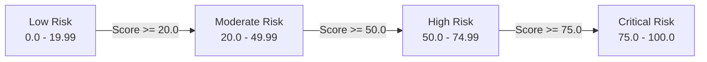

# FLOWGUARD Project-Specific Normalized Risk Index (PNRI) Methodology

---

## 1. Executive Summary & Purpose

The **Project-Specific Normalized Risk Index (PNRI)** is an empirical risk quantification framework developed specifically for the FLOWGUARD assessment platform. 

Standard vulnerability scoring frameworks (such as CVSS v3.1) assess vulnerabilities as isolated software flaws based on exploitability metrics (Attack Vector, Privileges Required, User Interaction). However, CVSS falls short when evaluating composite transactional systems where multiple business-logic flaws interact across state machines, inventory locks, and financial workflows.

PNRI provides:
1. A **normalized metric (0.0 to 100.0)** representing cumulative transactional risk.
2. A **strict mathematical alignment** between scenario weights and finding severity.
3. A **fail-closed completeness model** that prevents incomplete or error-laden assessments from ever being certified as secure.

> [!NOTE]
> **DISCLAIMER**: PNRI is a project-specific composite scoring methodology engineered for the FLOWGUARD laboratory platform. It is not an ISO, NIST, or FIRST industry standard.

---

## 2. Mathematical Formulation

### 2.1 The PNRI Formula

The Project-Specific Normalized Risk Index is calculated as:

$$\text{PNRI} = \left(\frac{R_{\text{confirmed}}}{R_{\text{max}}}\right) \times 100$$

Where:
- $R_{\text{confirmed}}$ is the sum of raw severity weights for all **confirmed** security findings.
- $R_{\text{max}}$ is the maximum achievable raw risk score across all evaluated scenarios ($R_{\text{max}} = 125$).

$$\text{PNRI} = \left(\frac{\sum_{i \in \text{Confirmed Flaws}} W_i}{125}\right) \times 100$$

### 2.2 Severity Weighting Framework

Weights are assigned deterministically based on finding severity:

| Severity Level | Point Weight ($W$) | Business Impact Justification |
| :--- | :---: | :--- |
| **CRITICAL** | **25 Points** | Direct financial theft, uncollectible inventory fulfillment, or catastrophic tenant privacy compromise. |
| **HIGH** | **15 Points** | Promotional budget depletion, inventory exhaustion, state machine corruption, or unauthorized price manipulation. |
| **MEDIUM** | **8 Points** | Non-financial logic errors or minor state inconsistencies (Reserved for future scenarios). |
| **LOW** | **3 Points** | Informational discrepancies or minor timing deviations (Reserved for future scenarios). |

### 2.3 Scenario Weight Allocations

FLOWGUARD's canonical test suite comprises seven scenarios:

| Scenario ID | Attack Surface | Assigned Severity | Weight ($W_i$) | Percentage of Total Risk |
| :---: | :--- | :---: | :---: | :---: |
| **TC-01** | Payment Bypass | CRITICAL | 25 | 20.0% |
| **TC-02** | Coupon Reuse | HIGH | 15 | 12.0% |
| **TC-03** | Duplicate Order Creation | HIGH | 15 | 12.0% |
| **TC-04** | Order IDOR | CRITICAL | 25 | 20.0% |
| **TC-05** | Invalid Workflow Transitions | HIGH | 15 | 12.0% |
| **TC-06** | Concurrent Checkout Race | HIGH | 15 | 12.0% |
| **TC-07** | Client-Side Price Tampering | HIGH | 15 | 12.0% |
| **TOTAL** | **All 7 Attack Surfaces** | — | **125** | **100.0%** |

---

## 3. Qualitative Risk Bands

The normalized PNRI score maps to four qualitative risk tiers:

| Risk Band | Score Range | Operational Meaning | Recommended Action |
| :--- | :---: | :--- | :--- |
| **LOW** | **0.0 – 19.99** | **Resilient**: Target successfully enforced all critical transactional invariants. Minor observations only. | Production deployment approved from a business-logic standpoint. |
| **MODERATE** | **20.0 – 49.99** | **Elevated**: One or two high-severity flaws confirmed (e.g. coupon reuse or idempotency replay). | Schedule code remediation before major release. |
| **HIGH** | **50.0 – 74.99** | **Dangerous**: Multiple high/critical vulnerabilities confirmed. Risk of significant financial or data loss. | Block release until core flaws are addressed. |
| **CRITICAL** | **75.0 – 100.0** | **Severe Compromise**: Widespread failure across core invariants. Arbitrary pricing, unpaid orders, or cross-tenant IDOR active. | Immediate executive escalation; halt operations. |

---

## 4. Assessment Completeness & Fail-Closed Logic

### 4.1 Completeness Metric

An assessment's validity depends on its completeness:

$$C = \left(\frac{N_{\text{conclusive}}}{N_{\text{total}}}\right) \times 100 = \left(\frac{N_{\text{PASS}} + N_{\text{FAIL}}}{7}\right) \times 100$$

### 4.2 Handling of Unresolved Scenarios

Scenarios can return one of four statuses:
1. **`PASS`**: Invariant verified intact. Flaw absent. Conclusive.
2. **`FAIL`**: Invariant breached. Flaw confirmed in ground truth. Generates canonical finding. Conclusive.
3. **`INCONCLUSIVE`**: Environmental precondition failed (e.g., target coupon missing or network timeout). Unverified. **Inconclusive**.
4. **`ERROR`**: Unhandled exception during scenario execution. **Inconclusive**.

### 4.3 Fail-Closed Rules

> [!CAUTION]
> **Core Policy**: An incomplete assessment can **NEVER** be certified as secure.

- **Zero Risk Contribution for Unverified Scenarios**: If a scenario returns `INCONCLUSIVE` or `ERROR`, it contributes **0 points** to the confirmed raw score ($R_{\text{confirmed}}$). This ensures that FLOWGUARD never fabricates vulnerabilities without observable proof.
- **Completeness Penalty**: However, unresolved scenarios reduce completeness below 100.0%.
- **High-Visibility Warnings**: Whenever $C < 100.0\%$, all outputs (CLI, Streamlit, and PDF reports) render prominent security warning banners:
  > *INCOMPLETE ASSESSMENT WARNING: One or more scenario evaluations encountered execution errors or returned inconclusive results. Under FLOWGUARD security policy, AN INCOMPLETE ASSESSMENT CAN NEVER BE CERTIFIED AS SECURE.*

---

## 5. Concrete Calculation Examples

### Example A: Completely Vulnerable Target (All Flaws Confirmed)
- Scenarios: TC-01 (`FAIL`), TC-02 (`FAIL`), TC-03 (`FAIL`), TC-04 (`FAIL`), TC-05 (`FAIL`), TC-06 (`FAIL`), TC-07 (`FAIL`).
- $R_{\text{confirmed}} = 25 + 15 + 15 + 25 + 15 + 15 + 15 = 125$.
- $\text{PNRI} = \frac{125}{125} \times 100 = \mathbf{100.00}$.
- Risk Band: **CRITICAL**.
- Completeness: $\frac{7}{7} \times 100 = \mathbf{100.0\%}$.

### Example B: Completely Secure Target (All Defenses Verified)
- Scenarios: TC-01 (`PASS`), TC-02 (`PASS`), TC-03 (`PASS`), TC-04 (`PASS`), TC-05 (`PASS`), TC-06 (`PASS`), TC-07 (`PASS`).
- $R_{\text{confirmed}} = 0$.
- $\text{PNRI} = \frac{0}{125} \times 100 = \mathbf{0.00}$.
- Risk Band: **LOW**.
- Completeness: $\frac{7}{7} \times 100 = \mathbf{100.0\%}$.

### Example C: Partial Vulnerability with Concurrency Inconclusive
- Scenarios: TC-01 (`FAIL`), TC-02 (`FAIL`), TC-03 (`FAIL`), TC-04 (`FAIL`), TC-05 (`FAIL`), TC-06 (`INCONCLUSIVE`), TC-07 (`FAIL`).
- $R_{\text{confirmed}} = 25 + 15 + 15 + 25 + 15 + 0 + 15 = 110$.
- $\text{PNRI} = \frac{110}{125} \times 100 = \mathbf{88.00}$.
- Risk Band: **CRITICAL**.
- Completeness: $\frac{6}{7} \times 100 = \mathbf{85.7\%}$ (Flags Incomplete Assessment Warning).
