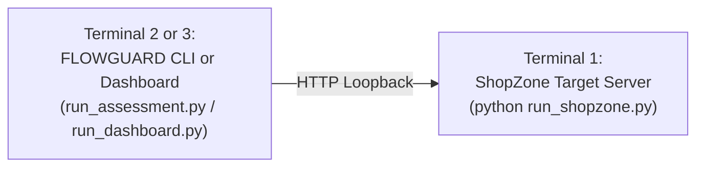

# FLOWGUARD User & Operations Guide

This guide provides operational instructions for executing security assessments, analyzing findings, inspecting evidence, reviewing history, and exporting executive reports using FLOWGUARD.

---

## 1. Getting Started: The Two-Process Model

FLOWGUARD operates as an independent client inspecting an authorized target. To conduct assessments, two separate processes must be running:

1. **Target Service (ShopZone)**: Serves the vulnerable and secure e-commerce APIs at `http://127.0.0.1:5000`.
2. **Assessment Interface (CLI or Streamlit)**: Executes the assessment scenarios and reports outcomes.



---

## 2. Operating the Command-Line Interface (CLI)

The CLI tool (`run_assessment.py`) is ideal for automated CI/CD pipelines, quick regression tests, and headless environments.

### 2.1 Basic Usage

```powershell
python run_assessment.py --mode <vulnerable|secure> [options]
```

### 2.2 CLI Arguments Reference

| Option | Type | Default | Description |
| :--- | :---: | :---: | :--- |
| `--mode` | string | **Required** | Target operating mode: `vulnerable` or `secure`. |
| `--target-url` | string | `http://127.0.0.1:5000` | Base URL of the ShopZone instance. |
| `--timeout` | float | `5.0` | Per-request HTTP timeout in seconds. |
| `--admin-key` | string | `os.getenv("ADMIN_KEY")` | Key used for authoritative ground-truth verification. |
| `--scenario` | string | `all` | Execute a specific scenario (e.g. `TC-01`) or `all`. |
| `--json` | flag | `False` | Output assessment results as sanitized JSON. |

### 2.3 Example Commands

#### Run Assessment Against Secure Target
```powershell
python run_assessment.py --mode secure
```

#### Run Assessment Against Vulnerable Target
```powershell
python run_assessment.py --mode vulnerable
```

#### Run a Single Scenario (e.g., IDOR Detection)
```powershell
python run_assessment.py --mode vulnerable --scenario TC-04
```

#### Export Assessment Summary as JSON
```powershell
python run_assessment.py --mode vulnerable --json > assessment_results.json
```

---

## 3. Operating the Streamlit Visual Dashboard

The Streamlit dashboard (`run_dashboard.py`) offers a graphical interface for interactive evaluation, visual analytics, evidence inspection, and report generation.

### 3.1 Launching the Dashboard

```powershell
python run_dashboard.py
```
By default, the dashboard starts on port 8501 and opens in your default web browser at `http://localhost:8501`.

### 3.2 Dashboard Feature Walkthrough

#### 1. Configuration & Execution Sidebar
- **Target Base URL**: Set to `http://127.0.0.1:5000` (Restricted to loopback hosts).
- **Target Operating Mode**: Toggle between **`vulnerable`** and **`secure`**.
- **Admin Key**: Pre-populated from `.env` (Masked input field).
- **Run Assessment Button**: Initiates sequential scenario execution. Overlapping clicks are prevented by execution state locks.

#### 2. Assessment Overview & Metrics Cards
- **PNRI Score (0.0 to 100.0)**: Color-coded radial gauge indicating overall transactional risk.
- **Risk Band**: Displays qualitative rating (`LOW`, `MODERATE`, `HIGH`, `CRITICAL`).
- **Completeness Meter**: Shows percentage of conclusive scenarios (Flags warning if `< 100%`).
- **Execution Metadata**: Assessment ID, timestamp, target mode, and elapsed time.

#### 3. Scenario Results Matrix
A consolidated table listing TC-01 through TC-07:
- **Scenario ID & Title**.
- **Status Badge**:
  - <font color="#16A34A">**PASS**</font>: Invariant held firm. Defense verified.
  - <font color="#DC2626">**FAIL**</font>: Business logic bypassed. Vulnerability confirmed.
  - <font color="#6B7280">**INCONCLUSIVE**</font>: Precondition failed or race uncorroborated.
  - <font color="#D97706">**ERROR**</font>: Runtime exception during evaluation.
- **Duration**: Milliseconds elapsed.
- **Diagnostic Observation**: Full behavioral summary.

#### 4. Findings & Evidence Viewer
- Expandable cards for each confirmed vulnerability.
- Displays canonical finding ID, CWE identifier, severity, description, impact analysis, and remediation steps.
- **Sanitized Evidence Viewer**: Inspects HTTP requests and responses (status codes, headers, and payloads). All passwords, session tokens, and admin keys are automatically redacted as `***REDACTED***`.

#### 5. Assessment History
- Chronological list of historical assessment runs saved to disk.
- Select any past assessment to instantly load and inspect its score, scenarios, and evidence without re-executing attacks.

#### 6. Executive PDF Export
- Click **"📥 Download PDF Report"** at the top of the active assessment view to immediately generate and download the executive report.
- In the **Assessment History** tab, click **"📥 PDF"** next to any prior run to download its corresponding PDF report on demand.

---

## 4. Programmatic Python API

For custom automation, FLOWGUARD components can be instantiated directly in Python:

### 4.1 Running an Assessment Programmatically
```python
from flowguard.config import FlowGuardConfig
from flowguard.runner import AssessmentRunner

# 1. Initialize configuration from environment
config = FlowGuardConfig(
    base_url="http://127.0.0.1:5000",
    target_mode="secure",
    timeout=5.0,
)

# 2. Instantiate runner and execute all scenarios
runner = AssessmentRunner(config)
summary = runner.run_all()

# 3. Inspect results
print(f"Assessment ID: {summary.assessment_id}")
print(f"PNRI Score:    {summary.pnri_score:.2f} ({summary.risk_band} Risk)")
print(f"Completeness:  {summary.completeness_pct:.1f}%")
print(f"Findings:      {len(summary.findings)} confirmed")
```

### 4.2 Loading Historical Records
```python
from flowguard.history import AssessmentHistoryStore

store = AssessmentHistoryStore()
recent_records = store.list_assessments()

for rec in recent_records[:5]:
    print(f"ID: {rec['assessment_id']} | Mode: {rec['mode']} | PNRI: {rec['pnri_score']}")

# Load full record
summary_dict = store.load_assessment(recent_records[0]["assessment_id"])
```

### 4.3 Generating an Executive PDF Report
```python
from flowguard.history import AssessmentHistoryStore
from flowguard.reporting import generate_pdf_report

store = AssessmentHistoryStore()
latest_id = store.list_assessments()[0]["assessment_id"]
summary_dict = store.load_assessment(latest_id)

pdf_bytes = generate_pdf_report(
    summary_dict,
    output_path="FLOWGUARD_Executive_Report.pdf"
)
print(f"Report generated: {len(pdf_bytes)} bytes written.")
```

---

## 5. Maintenance & Resetting Laboratory State

Over repeated assessment runs, ShopZone's local SQLite databases accumulate synthetic test users, completed orders, and redeemed coupons.

To restore the target databases to their clean initial seed state:

### Method A: Via HTTP Admin Endpoint
Submit an authorized `POST` request to `/api/admin/reset`:

```powershell
python -c "import urllib.request; req = urllib.request.Request('http://127.0.0.1:5000/api/admin/reset', headers={'X-Admin-Key': 'flowguard_admin_secret_key_change_me_local_lab', 'Content-Type': 'application/json'}, data=b'{\"target\": \"all\"}'); resp = urllib.request.urlopen(req); print(resp.read().decode())"
```

### Method B: Via Python Module
```python
from shopzone.db import reset_db

# Wipes and re-seeds both vulnerable and secure databases
reset_db(mode="all", seed=True)
print("Databases successfully reset.")
```
